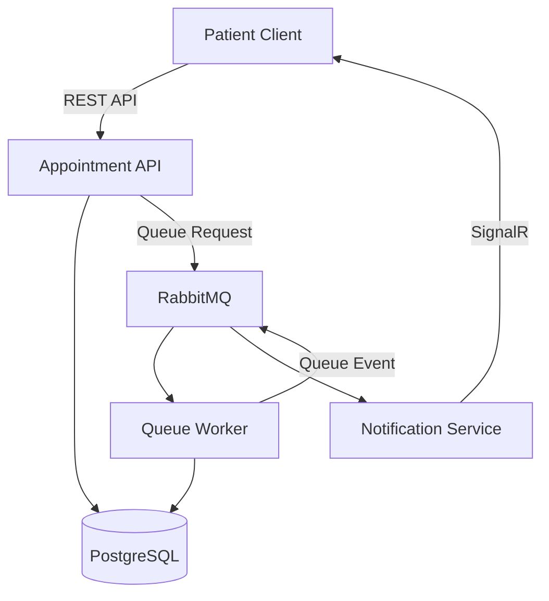

# SYSTEM ARCHITECTURE

## 1. Tổng quan
Hệ thống sử dụng kiến trúc ứng dụng phân tán gồm Patient Client, Appointment API, Queue Worker và Notification Service.

Các dịch vụ giao tiếp thông qua REST API, RabbitMQ và SignalR.

## 2. Sơ đồ kiến trúc

## 3. Vai trò các thành phần

### Patient Client
- Tìm kiếm bác sĩ.
- Xem lịch khám còn trống.
- Đặt lịch và hủy lịch.
- Theo dõi trạng thái lịch hẹn và số thứ tự.

### Appointment API
- Cung cấp REST API.
- Quản lý thông tin lịch hẹn.
- Lưu dữ liệu vào PostgreSQL.
- Gửi yêu cầu cấp số thứ tự qua RabbitMQ.

### Queue Worker
- Nhận yêu cầu cấp số thứ tự.
- Xử lý và phân bổ số thứ tự khám.
- Cập nhật dữ liệu hàng đợi.

### Notification Service
- Nhận sự kiện thay đổi hàng đợi.
- Gửi thông báo đến Patient Client thông qua SignalR.

### PostgreSQL
Lưu trữ thông tin bệnh nhân, bác sĩ, lịch khám, lịch hẹn và hàng đợi.

### RabbitMQ
Truyền tải message giữa Appointment API, Queue Worker và Notification Service.

## 4. Luồng xử lý đặt lịch
1. Bệnh nhân gửi yêu cầu đặt lịch từ Patient Client.
2. Appointment API tiếp nhận và kiểm tra lịch khám.
3. Appointment API lưu thông tin lịch hẹn vào PostgreSQL.
4. Appointment API gửi yêu cầu cấp số thứ tự đến RabbitMQ.
5. Queue Worker nhận yêu cầu và xử lý cấp số.
6. Queue Worker cập nhật trạng thái và số thứ tự vào PostgreSQL.
7. Sự kiện thay đổi hàng đợi được gửi qua RabbitMQ.
8. Notification Service nhận sự kiện và gửi thông báo qua SignalR.
9. Patient Client nhận thông báo theo thời gian thực.
