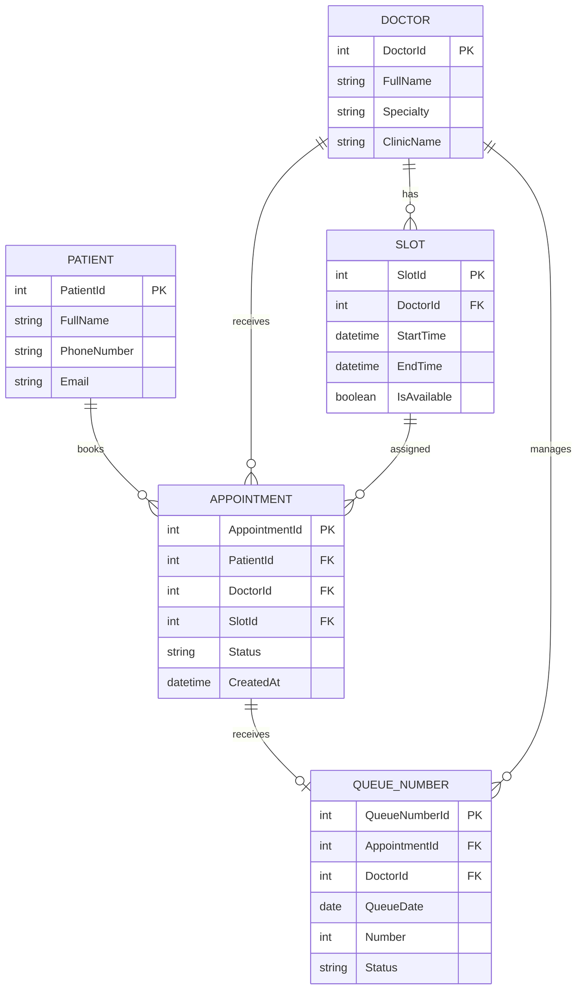

# DATABASE DESIGN

## 1. Các thực thể chính

### Patient
Lưu thông tin bệnh nhân.
- PatientId: khóa chính
- FullName: họ tên
- PhoneNumber: số điện thoại
- Email: email

### Doctor
Lưu thông tin bác sĩ.
- DoctorId: khóa chính
- FullName: họ tên
- Specialty: chuyên khoa
- ClinicName: phòng khám

### Slot
Lưu lịch khám của bác sĩ.
- SlotId: khóa chính
- DoctorId: khóa ngoại
- StartTime: thời gian bắt đầu
- EndTime: thời gian kết thúc
- IsAvailable: trạng thái còn trống

### Appointment
Lưu thông tin đặt lịch khám.
- AppointmentId: khóa chính
- PatientId: khóa ngoại
- DoctorId: khóa ngoại
- SlotId: khóa ngoại
- Status: trạng thái lịch hẹn
- CreatedAt: thời gian tạo

### QueueNumber
Lưu số thứ tự khám.
- QueueNumberId: khóa chính
- AppointmentId: khóa ngoại
- DoctorId: khóa ngoại
- QueueDate: ngày khám
- Number: số thứ tự
- Status: trạng thái hàng đợi

## 2. Sơ đồ quan hệ

## 3. Ghi chú
Đây là thiết kế dữ liệu ban đầu phục vụ giai đoạn phân tích và thiết kế. Kiểu dữ liệu, ràng buộc, chỉ mục và các quy tắc nghiệp vụ sẽ được hoàn thiện khi triển khai Entity Framework Core và PostgreSQL.
